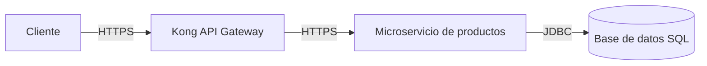

# Modelo de amenazas STRIDE: API de consulta de productos

## 1. Información general

| Campo | Detalle |
| --- | --- |
| Sistema | API de consulta de productos |
| Archivo de origen | `get-products-api.tm7` |
| Herramienta | Microsoft Threat Modeling Tool |
| Metodología | STRIDE |
| Alcance | Flujo desde el cliente hasta la base de datos, pasando por Kong API Gateway y el microservicio de productos |
| Estado de las amenazas | Generadas automáticamente; pendientes de revisión y validación |

## 2. Objetivo

Identificar las amenazas de seguridad asociadas a la consulta de productos y definir controles para proteger la **autenticidad, integridad, disponibilidad y confidencialidad** de la información, así como para prevenir la elevación de privilegios entre los componentes.

## 3. Arquitectura y flujos de datos

### 3.1 Componentes

| Componente | Tipo | Responsabilidad |
| --- | --- | --- |
| Cliente | Interactor externo | Solicita información de productos a través de la API. |
| Kong API Gateway | Proceso | Recibe las solicitudes externas y las dirige al microservicio. |
| Microservicio de productos | Servicio web | Procesa las solicitudes y consulta la información de productos. |
| DB | Base de datos SQL | Almacena y suministra los datos de productos. |

### 3.2 Flujos

| ID | Origen | Destino | Protocolo | Datos o propósito |
| --- | --- | --- | --- | --- |
| F-01 | Cliente | Kong API Gateway | HTTPS | Solicitudes y respuestas de la API. |
| F-02 | Kong API Gateway | Microservicio de productos | HTTPS | Solicitudes autorizadas hacia el servicio interno. |
| F-03 | Microservicio de productos | DB | JDBC | Consultas SQL y resultados de productos. |

## 4. Clasificación STRIDE

| Letra | Categoría | Propiedad de seguridad afectada |
| --- | --- | --- |
| S | Suplantación de identidad (*Spoofing*) | Autenticidad |
| T | Manipulación de datos (*Tampering*) | Integridad |
| R | Repudio (*Repudiation*) | No repudio y trazabilidad |
| I | Divulgación de información (*Information Disclosure*) | Confidencialidad |
| D | Denegación de servicio (*Denial of Service*) | Disponibilidad |
| E | Elevación de privilegios (*Elevation of Privilege*) | Autorización |

## 5. Amenazas identificadas

Todas las amenazas tienen prioridad **alta** y estado **generado automáticamente**. Las mitigaciones descritas son controles recomendados; su implementación debe verificarse antes de cambiar el estado de una amenaza a mitigada.

| ID | Categoría | Amenaza | Componente o flujo | Mitigación recomendada |
| --- | --- | --- | --- | --- |
| TM-01 | **T — Manipulación** | Manipulación de la memoria del proceso Kong API Gateway. Un componente con acceso a memoria compartida o con capacidad para controlar ejecuciones podría alterar el comportamiento del microservicio. | F-02: Kong → Microservicio | Aislar los procesos y evitar memoria compartida o punteros entre componentes. Intercambiar únicamente datos validados, copiar las entradas antes de utilizarlas y aplicar privilegios mínimos. |
| TM-02 | **E — Elevación de privilegios** | El microservicio de productos podría suplantar el contexto de seguridad de Kong para obtener privilegios adicionales. | F-02: Kong → Microservicio | Utilizar identidades independientes para Kong y el microservicio. Aplicar privilegios mínimos, validar emisor, audiencia y permisos de los tokens, y evitar reutilizar credenciales administrativas entre servicios. |
| TM-03 | **S — Suplantación** | Un atacante podría suplantar la base de datos y hacer que las consultas o los datos se dirijan a un destino controlado por él. | F-03: Microservicio → DB | Autenticar el servidor de base de datos mediante TLS y validación de certificados. Proteger la configuración de conexión y almacenar las credenciales en un gestor de secretos. |
| TM-04 | **T — Manipulación** | Posible vulnerabilidad de inyección SQL si se construyen consultas mediante concatenación de entradas no confiables. | Microservicio y DB mediante JDBC | Utilizar consultas parametrizadas o mecanismos seguros del ORM. No concatenar entradas en sentencias SQL, validar los parámetros y asignar a la cuenta de la aplicación únicamente los permisos necesarios. |
| TM-05 | **D — Denegación de servicio** | Consumo excesivo de recursos en el microservicio o en la base de datos que impida atender solicitudes legítimas. | F-03: Microservicio → DB | Aplicar límites de peticiones en Kong, paginación, tiempos máximos de espera, pools de conexiones acotados y límites de consulta. Supervisar CPU, memoria, conexiones y latencia, y definir alertas. |
| TM-06 | **T — Manipulación** | Un atacante podría leer o modificar los datos transmitidos por un flujo autenticado si el canal JDBC no está protegido adecuadamente. | F-03: Microservicio → DB | Cifrar la conexión JDBC con TLS, validar certificados, proteger las credenciales y comprobar que la configuración no permita degradar el canal a una conexión sin cifrado. |

## 6. Detalle y tratamiento

### TM-01 — Manipulación de memoria entre procesos

- **STRIDE:** Tampering.
- **Descripción original:** Kong API Gateway podría manipular el microservicio si recibe acceso a memoria compartida, punteros o control sobre el código que este ejecuta.
- **Riesgo:** Alteración del comportamiento del servicio y de los datos procesados.
- **Controles:** aislamiento de procesos o contenedores, comunicación exclusivamente mediante datos, validación de entradas y privilegios mínimos.
- **Estado:** Pendiente de validación.

### TM-02 — Elevación de privilegios mediante suplantación de contexto

- **STRIDE:** Elevation of Privilege.
- **Descripción original:** El microservicio podría impersonar el contexto de Kong API Gateway para obtener privilegios adicionales.
- **Riesgo:** Acceso a operaciones o recursos no autorizados.
- **Controles:** identidades separadas, autorización en cada componente y validación estricta de credenciales y tokens.
- **Estado:** Pendiente de validación.

### TM-03 — Suplantación del almacén de datos

- **STRIDE:** Spoofing.
- **Descripción original:** La base de datos podría ser suplantada por un atacante, desviando las operaciones hacia un destino malicioso.
- **Riesgo:** Pérdida de autenticidad, exposición de credenciales y envío de información a un servidor no confiable.
- **Controles:** autenticación del servidor, TLS, validación de certificados y protección de la configuración.
- **Estado:** Pendiente de validación.

### TM-04 — Inyección SQL

- **STRIDE:** Tampering.
- **Descripción original:** Código malicioso insertado en cadenas podría llegar a SQL Server para su análisis y ejecución.
- **Riesgo:** Modificación o acceso no autorizado a datos y ejecución de consultas no previstas.
- **Controles:** consultas parametrizadas, validación de parámetros, revisión de consultas dinámicas y privilegios mínimos en la base de datos.
- **Estado:** Pendiente de validación.

### TM-05 — Consumo excesivo de recursos

- **STRIDE:** Denial of Service.
- **Descripción original:** El microservicio o la base de datos podrían no controlar explícitamente el consumo de recursos, provocando bloqueos o degradación del servicio.
- **Riesgo:** Indisponibilidad total o parcial de la API.
- **Controles:** límites de consumo, rate limiting, paginación, timeouts, pools acotados, monitoreo y alertas.
- **Estado:** Pendiente de validación.

### TM-06 — Compromiso del flujo de datos autenticado

- **STRIDE:** Tampering.
- **Descripción original:** Un atacante podría leer o modificar la información transmitida por el flujo JDBC autenticado.
- **Riesgo:** Pérdida de integridad y posible exposición de la información intercambiada.
- **Controles:** TLS en JDBC, validación de certificados y protección de credenciales y configuración.
- **Estado:** Pendiente de validación.

## 7. Cobertura y observaciones

| Categoría | Cantidad | Amenazas |
| --- | ---: | --- |
| Suplantación (S) | 1 | TM-03 |
| Manipulación (T) | 3 | TM-01, TM-04, TM-06 |
| Repudio (R) | 0 | No generadas por la herramienta |
| Divulgación de información (I) | 0 | No generadas por la herramienta |
| Denegación de servicio (D) | 1 | TM-05 |
| Elevación de privilegios (E) | 1 | TM-02 |

La ausencia de amenazas de **repudio** y **divulgación de información** en el archivo generado no significa que no existan. Durante la revisión se recomienda evaluar, como mínimo:

- Registro de solicitudes, identidad del actor, fecha, operación y resultado, protegiendo los logs contra modificaciones.
- Exposición de datos en respuestas, mensajes de error, trazas y logs.
- Cifrado HTTPS extremo a extremo y validación de certificados también en los flujos F-01 y F-02.
- Gestión segura de secretos y rotación de credenciales.

## 8. Criterios para cerrar las amenazas

Cada amenaza podrá marcarse como mitigada cuando exista evidencia de que:

1. El control correspondiente está implementado.
2. Su configuración fue revisada y aprobada.
3. Existen pruebas que demuestran su efectividad.
4. El riesgo residual fue evaluado y aceptado por el responsable correspondiente.
